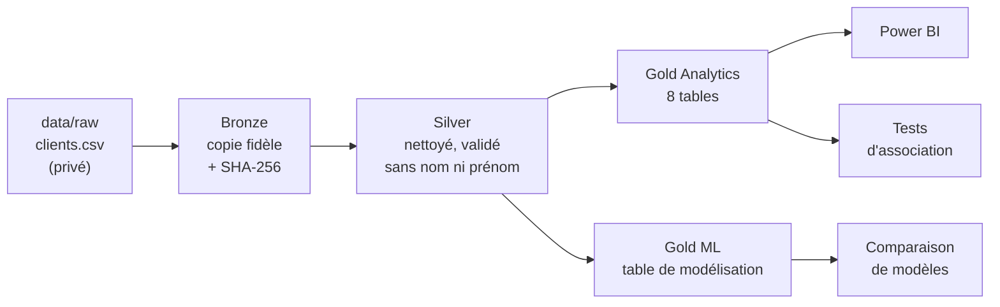

# Customer Analytics — profils de clients actifs et inactifs

Projet d'analyse de données de bout en bout sur un jeu de données bancaires anonymisé :
pipeline Python en architecture médaillon (Bronze → Silver → Gold), tests statistiques,
comparaison de modèles de classification et rapport Power BI.

**Question étudiée :** quelles caractéristiques démographiques et financières sont associées au
statut observé Actif / Inactif des clients ?

## Résultat principal

**Aucun signal d'association ou de discrimination n'a été mis en évidence avec les variables disponibles.**
Les résultats de cette étude descriptive ne permettent pas de justifier un ciblage commercial par âge,
ville, revenu, type de compte ou solde. L'absence de significativité ne prouve toutefois pas une
indépendance parfaite.

Les analyses descriptives, les tests d'association et les essais de classification réalisés
sur la source disponible n'ont pas mis en évidence de signal suffisamment robuste pour distinguer
les statuts observés avec les variables étudiées. Les métriques détaillées et les résultats chiffrés
sont générés localement et ne sont pas inclus dans le dépôt public, par précaution de confidentialité.

Cette conclusion ne démontre pas une indépendance parfaite et ne permet pas de conclure que les
données sont synthétiques. Elle peut s'expliquer par des informations absentes (activité
transactionnelle, ancienneté, produits détenus), par la définition métier du statut, par la
provenance des données ou par des relations trop faibles pour être détectées. Détails méthodologiques :
[`docs/methodology.md`](docs/methodology.md) et recommandations :
[`docs/recommendations.md`](docs/recommendations.md).

> **Limites.** Les données sont une photographie à un instant donné, sans historique. Ce projet ne
> prédit pas l'inactivité future (churn) et n'établit aucune cause.

## Architecture



| Couche | Fichier | Règle clé |
|---|---|---|
| Bronze | `data/bronze/clients.csv` | Copie octet pour octet, empreinte SHA-256 |
| Silver | `data/silver/clients_clean.parquet` | 9 règles de qualité bloquantes ; âges manquants conservés ; noms/prénoms retirés ; `client_id` conservé comme clé technique locale |
| Gold Analytics | `data/gold/analytics/gold_*.parquet` + `.csv` | 7 tables agrégées + 1 table de faits au niveau client ; totaux réconciliés avec Silver |
| Gold ML | `data/gold/ml/gold_ml_dataset.parquet` + `.csv` | Une ligne par client, sans identifiant ; imputation faite plus tard dans le pipeline d'entraînement |

## Démarrage rapide

Prérequis : Python 3.12 ou 3.13.

```bash
git clone https://github.com/VOTRE-COMPTE/customer-analytics-python.git
cd customer-analytics-python

python -m venv .venv
# Windows PowerShell :
.venv\Scripts\Activate.ps1
# macOS / Linux :
source .venv/bin/activate

pip install -r requirements.txt
```

Placez ensuite la source autorisée dans `data/raw/clients.csv`, puis lancez :

```bash
python -m src.pipeline      # audit, Bronze, Silver, Gold, tests statistiques, modèles (≈ 1 min)
pytest                      # suite de tests automatisés
```

Pas d'accès aux données ? `python -m src.utils.sample_data` crée une source synthétique au même
schéma, avec laquelle tout le pipeline s'exécute (les résultats diffèrent alors de ceux ci-dessus).

Pour explorer les résultats : `jupyter notebook notebooks/01_analyse_clients.ipynb`
(après le pipeline ; installez Jupyter avec `pip install notebook` si nécessaire).

### Étapes individuelles

```bash
python -m src.audit.audit_source             # rapport d'audit de la source
python -m src.bronze.ingest_bronze           # Bronze
python -m src.silver.build_silver            # Silver
python -m src.gold.build_gold_analytics      # Gold Analytics
python -m src.gold.build_gold_ml             # Gold ML
python -m src.analysis.association_tests     # tests d'association
python -m src.ml.train_models                # comparaison de modèles
```

## Organisation du dépôt

```text
customer-analytics-python/
├── src/
│   ├── config.py                 chemins, schéma et paramètres (source unique)
│   ├── pipeline.py               exécute toutes les étapes
│   ├── audit/                    audit de la source
│   ├── bronze/ silver/ gold/     couches médaillon
│   ├── analysis/                 tests d'association
│   ├── ml/                       comparaison de modèles
│   └── utils/                    entrées/sorties, données synthétiques
├── tests/                        suite pytest (données synthétiques + contrôles de confidentialité)
├── notebooks/
│   └── 01_analyse_clients.ipynb  analyse commentée (lit les couches, n'écrit rien)
├── reports/                      rapports agrégés générés par le pipeline
├── docs/                         dictionnaire, règles de qualité, méthodologie, audit
├── powerbi/                      rapport Power BI et sa documentation
└── data/                         jamais publié (voir data/README.md)
```

## Rapports générés

Le pipeline génère localement les rapports d'audit, de qualité Silver, de tests d'association et de
modélisation dans `reports/`. Ces fichiers sont ignorés par Git par défaut, car ils peuvent révéler
des informations dérivées de la source bancaire. Voir [`reports/README.md`](reports/README.md).

## Confidentialité

La source contient des noms et prénoms. Ils restent dans la couche Bronze, qui n'est jamais
publiée : la couche Silver et toutes les tables suivantes en sont dépourvues, et le `.gitignore`
exclut l'intégralité du dossier `data/`. Les tests de confidentialité contrôlent notamment les fichiers de sortie des notebooks, les
identifiants dans les tableaux et la présence éventuelle de noms/prénoms. Voir
[`docs/github_publication.md`](docs/github_publication.md).

## Documentation

- [`docs/data_dictionary.md`](docs/data_dictionary.md) — variables de la source et des tables Gold
- [`docs/data_quality_rules.md`](docs/data_quality_rules.md) — règles Silver et leur justification
- [`docs/methodology.md`](docs/methodology.md) — choix statistiques et de modélisation
- [`docs/audit_report.md`](docs/audit_report.md) — audit du dépôt et corrections apportées
- [`docs/recommendations.md`](docs/recommendations.md) — recommandations métier et limites d'usage
- [`docs/github_publication.md`](docs/github_publication.md) — publier le projet sur GitHub
- [`powerbi/README.md`](powerbi/README.md) — rapport Power BI

## Stack

Python · pandas · NumPy · SciPy · scikit-learn · Matplotlib · seaborn · PyArrow (Parquet) ·
pytest · GitHub Actions · Power BI
